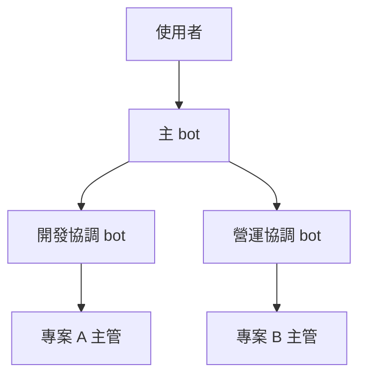
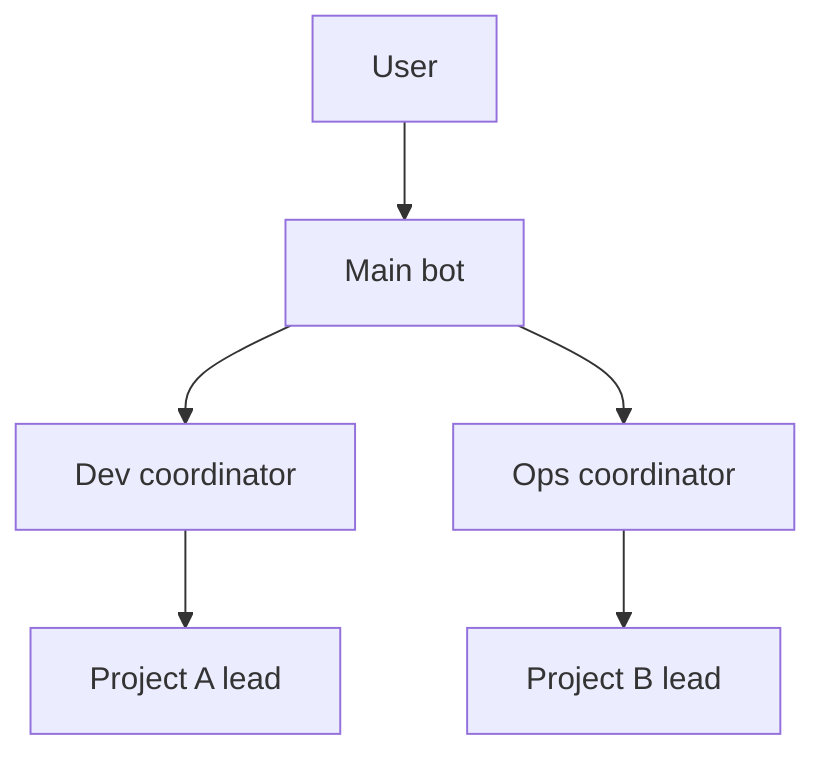

# grok-team

> **[繁體中文](#繁體中文)** | **[English](#english)**

---

## 繁體中文

這是給 Grok Bot 主 bot 用的組織框架。一位使用者可以有很多 bot，每個 bot 有自己的對話和記憶，檔案在同一台電腦上。主 bot 讀完這裡，訪談使用者，再一起訂出這個人自己的 bot 組織。

只寫給 Grok Bot。

### 怎麼開始

1. 開一個 private 的 GitHub repo，當組織的記憶庫。
2. 把這個 grok-team repo 的連結給主 bot。
3. 跟主 bot 說：「讀這份，然後訪談我。」

主 bot 一次問一題，先交出計畫。你點頭之後，它才建立 bot 和頻道。題目在 [docs/interview.md](docs/interview.md)。

### 範例組織

要幾層，看事情有多少。事情少，使用者 → 主 bot → 主管 就夠。事情多，可以在中間加協調層，也可以再加別的層。下面只是例子。

箭頭是管轄，由上往下。回報沿同一條線往上，一次只交一層。

- 主 bot 是特助，對使用者負責。
- 協調 bot 出主意、看方向，不動 repo。決定的人是使用者。
- 一個專案一個主管 bot。主管自己更新自己的進度頁。主管之間不直接聯絡，合作請上一層轉。
- 主 bot 和協調 bot 看結果和方向。專案裡的測試和品管，由那個專案自己做。

主管底下如果要再放一組團隊檔，看 A-Team 的 `grok-native` 分支當參考。那個專案會產出團隊：小專案用精簡流程（small office），大約 3 到 4 個階段、3 到 5 位專員，一個階段一份紀錄；大專案用完整流程。這裡只放連結：

https://github.com/chemistrywow31/A-Team/tree/chemistrywow31/grok-native

### 記憶掉了怎麼辦

Bot 會忘。一次摘要、一段新對話，講好的事可能就沒了。架構、名單、習慣、風格、決定，放在使用者的私人 repo。這份公開 repo 只放框架。

主 bot 目前不能自己建立 GitHub repo，有授權也不行。私人記憶庫要使用者自己開，並讓主 bot 讀得到、寫得進。訪談會問這一步。這個 repo 還沒好，就先不要建 bot。

每個 bot 開工前先讀它。主 bot 學到新習慣或新決定，就主動寫回去。改組織要先寫計畫，你點頭再 commit。寫決定，不貼對話原檔。

### 群組會吃額度

會議室是群組頻道。一個頻道最多 6 人，主 bot 算一個。bot 在裡面每回一則，就算進你的每週額度。只把重要決定放進群組。沒被點名就不要說話。

### 其他文件

- [AGENTS.md](AGENTS.md) — 主 bot 的入口
- [docs/architecture.md](docs/architecture.md) — 層級、誰做什麼
- [docs/operating-rules.md](docs/operating-rules.md) — 共同規則、八行回報、任務板、會議室
- [docs/interview.md](docs/interview.md) — 訪談題庫和收尾清單
- [docs/grok-bot-setup.md](docs/grok-bot-setup.md) — 建立 bot、頻道、傳話，以及已知限制
- [templates/lead-brief.md](templates/lead-brief.md) — 主管簡述
- [templates/coordinator-brief.md](templates/coordinator-brief.md) — 協調簡述
- [templates/roster.md](templates/roster.md) — 名單
- [templates/report-8-lines.md](templates/report-8-lines.md) — 八行回報
- [templates/task-board.md](templates/task-board.md) — 任務板
- [templates/memory-repo/AGENTS.md](templates/memory-repo/AGENTS.md) — 私人記憶庫骨架

---

## English

A framework for the main bot in Grok Bot. One person can run many bots. Each bot has its own chat and its own memory, and they share one computer's files. The main bot reads this repo, interviews that person, and helps them lay out their own bots.

Written for Grok Bot only.

### How to start

1. Create a private GitHub repo. That repo is the organization's memory.
2. Give the main bot the link to this grok-team repo.
3. Say: "Read this and interview me."

The main bot asks one question at a time, then writes a short plan. It creates bots and channels only after you agree. The questions are in [docs/interview.md](docs/interview.md).

### An example organization

The number of layers follows the amount of work. A small setup is user → main bot → lead. A larger one can add coordinators, or further layers. The chart is an example.

Arrows point down the chain of authority. Reports go back up that chain, one layer at a time.

- The main bot is the personal assistant and answers to the user.
- Coordinators advise and watch direction. They leave repos alone. The user decides.
- One project gets one lead bot. The lead updates its own progress page. Leads do not message each other. Work between them goes through the layer above.
- The main bot and the coordinators review results and direction. Testing and QA stay inside the project.

When a lead needs files for a team under that project, use the A-Team `grok-native` branch as a pointer. That project generates teams. Small work there uses a short flow (small office): about three or four stages, three to five specialists, one record per stage. Large work uses the full flow. The link is only a pointer:

https://github.com/chemistrywow31/A-Team/tree/chemistrywow31/grok-native

### When memory drops out

Bots forget. A summary or a new session can drop a decision you already made. Layout, roster, habits, style, and decisions belong in the private repo. This public repo keeps the framework.

The main bot cannot create a GitHub repo, even with GitHub access granted. You create the private repo and give the main bot access to read and write it. The interview asks for this. Create the bots only after that repo exists and the main bot can open it.

Every bot reads it before starting work. When the main bot learns a new habit or a new decision, it writes that back on its own. A change to the structure waits: plan first, commit after you agree. Write the decision, not a paste of the chat.

### Group chats spend quota

A group chat is a meeting room. The cap is six members, and the main bot counts as one. Each reply a bot sends in the room draws on your weekly quota. Save rooms for decisions that need them. A bot speaks only when it is named.

### Other docs

- [AGENTS.md](AGENTS.md) — entry file for the main bot
- [docs/architecture.md](docs/architecture.md) — layers and who does what
- [docs/operating-rules.md](docs/operating-rules.md) — shared rules, the eight-line report, the task board, meeting rooms
- [docs/interview.md](docs/interview.md) — question bank and closing checklist
- [docs/grok-bot-setup.md](docs/grok-bot-setup.md) — creating bots and channels, sending messages, known limits
- [templates/lead-brief.md](templates/lead-brief.md) — lead brief
- [templates/coordinator-brief.md](templates/coordinator-brief.md) — coordinator brief
- [templates/roster.md](templates/roster.md) — roster
- [templates/report-8-lines.md](templates/report-8-lines.md) — eight-line report
- [templates/task-board.md](templates/task-board.md) — task board
- [templates/memory-repo/AGENTS.md](templates/memory-repo/AGENTS.md) — skeleton for the private memory repo
