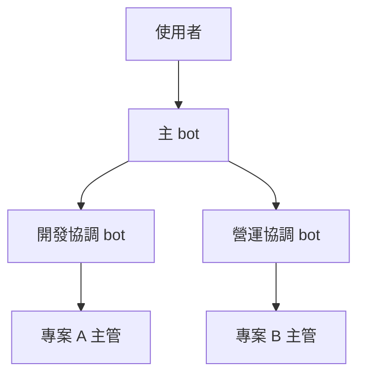
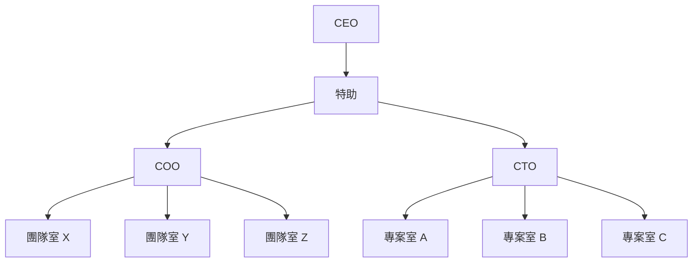
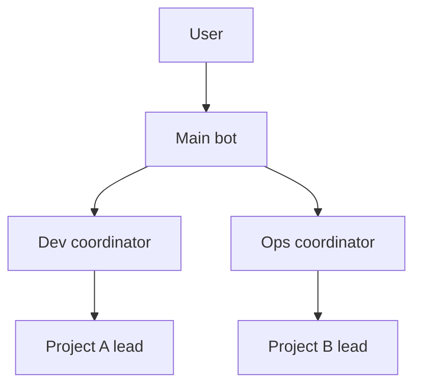
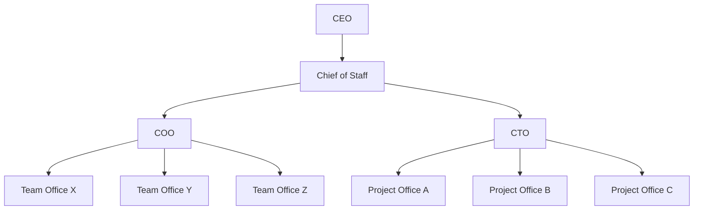

# grok-team

> **[繁體中文](#繁體中文)** | **[English](#english)**

---

## 繁體中文

這是給 Grok Bot 主 bot 用的組織框架。一位使用者可以有很多 bot，每個 bot 有自己的對話和記憶，檔案在同一台電腦上。主 bot 讀完這裡，訪談使用者，再一起訂出這個人自己的 bot 組織。

只寫給 Grok Bot。其餘文件是英文，給 bot 讀。你看這份中文就夠。你跟 bot 說話，用你自己的語言。

### 快速開始

1. 把下面這段貼給主 bot。你不用 clone，它也不能 clone。

   ```
   打開 https://github.com/chemistrywow31/grok-team ，用你的網頁抓取從網址讀檔，不要 clone。先讀 README.md 和 AGENTS.md，再順著連結讀用到的 docs 和 templates。raw 或 blob 都可以，例如 https://raw.githubusercontent.com/chemistrywow31/grok-team/main/AGENTS.md 。哪個打不開就說哪個，然後停，不要猜。接著照 AGENTS.md 一次問我一題，把計畫給我看。我明確同意之前，不要建立任何 bot。
   ```

2. 主 bot 從那個網址讀 `AGENTS.md` 和 docs，再依 [docs/interview.md](docs/interview.md) 一次問一題。它會拿出兩種編制讓你選或混用：自己當頭，或 CEO 底下兩層主管。然後寫一份計畫。你同意之前，它不會建立任何 bot。
3. 問到記憶庫時，你自己開一個 private 的 GitHub repo，並讓主 bot 讀得到、寫得進。它不能自己開 repo。原因在下面「記憶掉了怎麼辦」。
4. 你同意計畫之後，主 bot 才用 templates 寫入記憶庫、建立協調 bot 和主管 bot、填名單。bot 的 id 只放在那份私人名單。
5. 第一天做三件事：跟主 bot 講話、看往上送的八行回報、規則要改就先講一聲。你同意之後，它才改私人記憶庫裡的規則。

### 範例組織

要幾層，看事情有多少。事情少，使用者 → 主 bot → 主管 就夠。事情多，中間再加層。下面兩種都是例子，可以挑一種，也可以拆開再組。

#### 例子：自己當頭



箭頭是管轄，由上往下。回報沿同一條線往上，一次只交一層。

- 主 bot 是特助，對使用者負責。
- 協調 bot 出主意、看方向，不動 repo。決定的人是使用者。
- 一個專案一個主管 bot。主管自己更新自己的進度頁。主管之間不直接聯絡，合作請上一層轉。
- 主 bot 和協調 bot 看結果和方向。專案裡的測試和品管，由那個專案自己做。

#### 例子：CEO

人是 CEO。你已經有的主 bot 就是特助，不必再蓋一個。特助下面是 COO 和 CTO。CTO 管軟體，一個專案一間專案室。COO 管營運和內容，一個團隊一間團隊室。A、B、C、X、Y、Z 是代號，有工作才留。



管轄是 CEO → 特助 → COO 或 CTO → 室主管。回報倒著走，一次一層。要人拍板的事回到 CEO。

特助、COO、CTO 只協調、看方向。他們不做專案裡的測試或品管，也不改專案 repo。各室主管做該室的事，自己更新進度頁和任務板。室跟室不直接找，請上一層轉。

說明在 [docs/architecture.md](docs/architecture.md#example-ceo)。空的名單在 [templates/roster-ceo-example.md](templates/roster-ceo-example.md)。

主管底下如果要再放一組團隊檔，看 A-Team 的 `grok-native` 分支當參考。那個專案會產出團隊：小專案用精簡流程（small office），大約 3 到 4 個階段、3 到 5 位專員，一個階段一份紀錄；大專案用完整流程。這裡只放連結：

https://github.com/chemistrywow31/A-Team/tree/chemistrywow31/grok-native

### 記憶掉了怎麼辦

Bot 會忘。一次摘要、一段新對話，講好的事可能就沒了。架構、名單、習慣、風格、決定，放在使用者的私人 repo。這份公開 repo 只放框架。

主 bot 目前不能自己建立 GitHub repo，有授權也不行。私人記憶庫要使用者自己開，並讓主 bot 讀得到、寫得進。訪談會問這一步。這個 repo 還沒好，就先不要建 bot。

每個 bot 開工前先讀它。主 bot 學到新習慣或新決定，就主動寫回去。改組織要先寫計畫，你點頭再 commit。寫決定，不貼對話原檔。

### 群組會吃額度

會議室是群組頻道。一個頻道最多 6 人，主 bot 算一個。bot 在裡面每回一則，就算進你的每週額度。只把重要決定放進群組。沒被點名就不要說話。

### 其他文件

這些檔是英文。

- [AGENTS.md](AGENTS.md) — 主 bot 的入口，含訪談順序和語言規則
- [docs/architecture.md](docs/architecture.md) — 層級，以及上面兩種例子
- [docs/operating-rules.md](docs/operating-rules.md) — 共同規則、八行回報、任務板、會議室
- [docs/interview.md](docs/interview.md) — 訪談題庫。兩種編制都要拿出來選
- [docs/grok-bot-setup.md](docs/grok-bot-setup.md) — 建立 bot、頻道、傳話，以及已知限制
- [docs/prompt-quality.md](docs/prompt-quality.md) — 這些提示詞依了哪些寫法，以及刻意沒採用哪些
- [templates/lead-brief.md](templates/lead-brief.md) — 主管簡述
- [templates/coordinator-brief.md](templates/coordinator-brief.md) — 協調簡述
- [templates/roster.md](templates/roster.md) — 名單
- [templates/roster-ceo-example.md](templates/roster-ceo-example.md) — CEO 編制的名單例子
- [templates/report-8-lines.md](templates/report-8-lines.md) — 八行回報
- [templates/task-board.md](templates/task-board.md) — 任務板
- [templates/memory-repo/AGENTS.md](templates/memory-repo/AGENTS.md) — 私人記憶庫骨架

---

## English

A framework for the main bot in Grok Bot. One person can run many bots. Each bot has its own chat and its own memory, and they share one computer's files. The main bot reads this repo, interviews that person, and helps them lay out their own bots.

Written for Grok Bot only. The rest of the files are English, which is what the bots read. You talk to them in your own language.

### Quick start

1. Paste this to your main bot. Nothing gets cloned. The bot cannot clone, and you do not have to.

   ```
   Read https://github.com/chemistrywow31/grok-team by URL. Do not clone it. Open README.md and AGENTS.md first, then the docs/*.md and templates/*.md files those pages link, as raw or blob URLs, for example https://raw.githubusercontent.com/chemistrywow31/grok-team/main/AGENTS.md . Use your web fetch. If a file does not open, name the URL and stop. Do not guess. Then interview me one question at a time following AGENTS.md. Show me the plan. Do not create any bot until I explicitly say yes.
   ```

2. It reads `AGENTS.md` and the docs from that URL, then interviews you from [docs/interview.md](docs/interview.md), one question at a time. It offers two shapes, a founder/owner layout and a CEO layout with two exec layers, and you can pick or mix. It writes a plan. The bot creates nothing until you agree.
3. During the interview, create one private GitHub repo for memory and grant the bot access. The main bot cannot create that repo. The reason is under "When memory drops out" below.
4. After you agree, the main bot writes that memory repo from the templates, creates the coordinator and lead bots, and fills in the roster. Bot ids stay in the private roster.
5. On the first day, do three things: talk to the main bot, read the eight-line reports that come up, and say so if a rule needs a change. The bot writes the change into your private memory repo only after you agree.

### An example organization

How many layers you need follows the amount of work. A small setup is user → main bot → lead. A larger one adds layers. The two charts below are examples. Use one, or take pieces from both.

#### Example: owner



Arrows point down the chain of authority. Reports go back up that chain, one layer at a time.

- The main bot is the personal assistant and answers to the user.
- Coordinators advise and watch direction. They leave repos alone. The user decides.
- One project gets one lead bot. The lead updates its own progress page. Leads do not message each other. Work between them goes through the layer above.
- The main bot and the coordinators review results and direction. Testing and QA stay inside the project.

#### Example: CEO

The human is the CEO. The main bot already on the account is the chief of staff, so do not create another one. A COO bot and a CTO bot report to that chief of staff. Software projects sit under the CTO, one project office each. Operations and content sit under the COO, one team office each. A, B, C, X, Y, and Z are stand-in names. Keep a box only when there is work for it.



Authority runs CEO → Chief of Staff → COO or CTO → office lead. Reports travel back up, one layer at a time. A choice that needs a person goes back to the CEO.

The chief of staff, the COO, and the CTO coordinate and review. They do not run project QA, and they do not edit project repos. The office lead does that office's work and keeps its progress page and task board. Offices do not message each other. They ask the layer above.

The long version is in [docs/architecture.md](docs/architecture.md#example-ceo). A blank roster is in [templates/roster-ceo-example.md](templates/roster-ceo-example.md).

When a lead needs files for a team under that project, use the A-Team `grok-native` branch as a pointer. That project generates teams. Small work there uses a short flow (small office): about three or four stages, three to five specialists, one record per stage. Large work uses the full flow. The link is only a pointer:

https://github.com/chemistrywow31/A-Team/tree/chemistrywow31/grok-native

### When memory drops out

Bots forget. A summary or a new session can drop a decision you already made. Layout, roster, habits, style, and decisions belong in the private repo. This public repo keeps the framework.

The main bot cannot create a GitHub repo, even with GitHub access granted. You create the private repo and give the main bot access to read and write it. The interview asks for this. Create the bots only after that repo exists and the main bot can open it.

Every bot reads it before starting work. When the main bot learns a new habit or a new decision, it writes that back on its own. A change to the structure waits: plan first, commit after you agree. Write the decision, not a paste of the chat.

### Group chats spend quota

A group chat is a meeting room. The cap is six members, and the main bot counts as one. Each reply a bot sends in the room draws on your weekly quota. Save rooms for decisions that need them. A bot speaks only when it is named.

### Other docs

These files are English.

- [AGENTS.md](AGENTS.md) — entry file for the main bot: interview order and the language rule
- [docs/architecture.md](docs/architecture.md) — layers, including both example shapes
- [docs/operating-rules.md](docs/operating-rules.md) — shared rules, the eight-line report, the task board, meeting rooms
- [docs/interview.md](docs/interview.md) — question bank; offer both shapes
- [docs/grok-bot-setup.md](docs/grok-bot-setup.md) — creating bots and channels, sending messages, known limits
- [docs/prompt-quality.md](docs/prompt-quality.md) — which prompt rules this repo follows, and which it leaves out
- [templates/lead-brief.md](templates/lead-brief.md) — lead brief
- [templates/coordinator-brief.md](templates/coordinator-brief.md) — coordinator brief
- [templates/roster.md](templates/roster.md) — roster
- [templates/roster-ceo-example.md](templates/roster-ceo-example.md) — sample roster for the CEO shape
- [templates/report-8-lines.md](templates/report-8-lines.md) — eight-line report
- [templates/task-board.md](templates/task-board.md) — task board
- [templates/memory-repo/AGENTS.md](templates/memory-repo/AGENTS.md) — skeleton for the private memory repo
