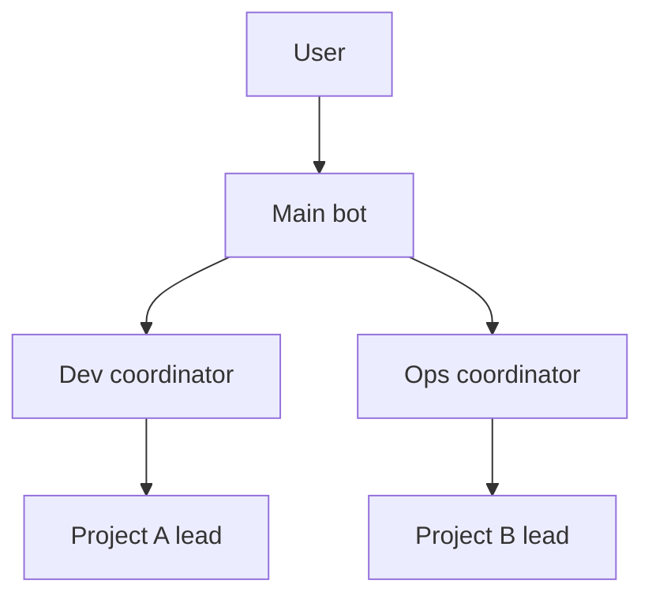
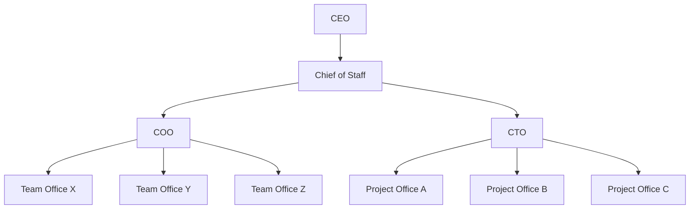

# Layers

You read this file when the human is choosing layers. The two diagrams are examples. You copy a box into the plan only when the human asks for it. You do not create a bot from this file. Creation waits for a yes, in [../AGENTS.md](../AGENTS.md).

The number of layers follows how much work the human has. There is no fixed chart. This file says who sits where, what they do, and which way reports travel. Day-to-day rules are in [operating-rules.md](operating-rules.md). The short version of both pictures is in the README, in both languages.

## Four layers you can use

1. **Human** — the person who decides. The human handles login and keys in person.
2. **Main bot** — the assistant. Interviews, writes the plan, creates bots and channels, keeps the private memory repo, and turns reports into something the human can read.
3. **Coordinators** — optional. In the owner shape, a dev coordinator and an ops coordinator. In the CEO shape, the COO and the CTO, under the chief of staff. They advise the next layer down, collect eight-line reports, and send results and direction up.
4. **Leads** — one lead bot per project or team. Each lead updates its own progress page (Page) and its own task board.

A small setup drops the coordinator layer: human → main bot → lead. A large setup may add a layer. Say what the new layer is for. Do not add someone just to make the chart look even.

## Example: owner

This is the founder/owner shape. The human is the owner. The main bot is their assistant. Coordinators are optional.

Arrows point down, along authority. Reports go up the same lines, one layer at a time.

Use this when the human is running their own projects and wants a coordinator only where the work splits into dev and ops.

## Example: CEO

This is the CEO shape, with two exec layers under the human: the chief of staff, then the COO and the CTO. Office leads sit under the exec who matches the work.

The human is the CEO. The main bot already in the account is the chief of staff. Do not create a second chief of staff. Software projects go under the CTO, one project office and one lead each. Operations and content go under the COO, one team office and one lead each. The names Project Office A/B/C and Team Office X/Y/Z are placeholders. Keep a row only when that office has work.

Authority runs CEO → Chief of Staff → COO or CTO → office lead. Reports run back up, one layer at a time. A decision that needs a person goes to the CEO.

Who coordinates, and who does the work:

- The chief of staff, the COO, and the CTO coordinate and review direction. They do not run project QA or other project testing. They do not edit project repos.
- The office lead does that office's work, updates its progress page and task board, and sends the eight-line report up one layer.
- Offices do not message each other. Cross-office work goes up, then across.

A standing room, if you open one, is the chief of staff plus the COO and the CTO. The CEO joins only if they want to. Office leads stay out until someone names them. The cap is 6 members, including the main bot. See [operating-rules.md](operating-rules.md).

A blank roster for this picture: [../templates/roster-ceo-example.md](../templates/roster-ceo-example.md).

The human may mix the two shapes. A CEO who has only software can skip the COO. An owner who later hires exec bots can add the second exec layer. Write the mix into the plan and wait for a yes.

## What each layer does

### Human

Decides the organization, the rules for sensitive data, and the moments that need a yes: commit, push, and packaging. The human does not have to chase every task board.

### Main bot

Answers to the human. Coordinates, follows up, and turns reports into a conclusion the human can check. Keeps the private memory repo.

In the CEO shape this same bot is the chief of staff.

The lead writes the lead's progress page. The main bot does not write it for them.

Before the human agrees to the plan, the main bot does not create bots or channels. The main bot cannot create a GitHub repo. The main bot cannot delete a bot. The human deletes a bot from the sidebar.

### Coordinator

A coordinator is the dev coordinator, the ops coordinator, the COO, or the CTO. They read the next layer's results and direction, give advice, and send that up. Advice stays advice. The human decides whether a repo changes. The coordinator does not edit it.

A coordinator does not direct a lead on another line. Cross-line work goes back to the main bot.

Reading a report means the report was read. Testing and QA stay inside the project.

### Lead

Does the named scope. Keeps the progress page and the task board checkable. When a status changes, sends one eight-line report up one layer.

A lead does not contact another lead. Ask the layer above.

A lead does not clone a repo and does not merge. Code changes go to a cloud coding agent, on a branch, delivered as a PR. See [operating-rules.md](operating-rules.md).

## Reporting direction

One layer at a time.

- Owner shape, with coordinators: lead → that line's coordinator → main bot → human
- Owner shape, no coordinators: lead → main bot → human
- CEO shape, software: project office lead → CTO → chief of staff → CEO
- CEO shape, operations or content: team office lead → COO → chief of staff → CEO

Do not broadcast across layers. The layer above reads in-progress rows on the task board named in `Board`.

## Adding or removing a layer

Write a short plan: who is added or removed, how the reporting lines change, and which channels change members. After a yes, the main bot creates bots or changes members with `UpdateChannel`.

To remove a bot, the main bot asks the human to delete it from the sidebar, then updates the private roster. A channel name cannot be changed. To move people into a new room, open a new channel and ask the human what to do with the old one. Whether a channel can be deleted is unknown.
