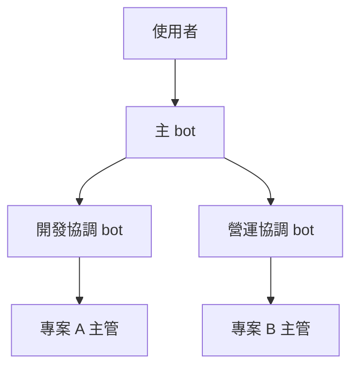

# 層級

層數看使用者的事情有多少，沒有固定編制。這份講誰在哪一層、做什麼、回報往哪走。日常規則見 [operating-rules.md](operating-rules.md)。

## 可以由上到下的四層

1. **使用者** — 做決定的人。登入和金鑰由使用者本人處理。
2. **主 bot** — 特助。訪談、寫計畫、建立 bot 和頻道、維護私人記憶庫、把下面的回報整理給使用者。
3. **協調層** — 可選。例如開發協調 bot、營運協調 bot。對下一層給建議，收八行回報，再往上交結果和方向。
4. **主管** — 一個專案一個主管 bot。自己的進度頁（Page）和任務板，自己更新。

事情少，拿掉協調層：使用者 → 主 bot → 主管。事情多，可以再加層。加層要說得清這一層管什麼。不要為了看起來整齊而加人。

下面是例子。實際層級以訪談結果為準。

## 各層的工作

### 使用者

決定組織、敏感資料的規則、以及 commit、push、打包這類要點頭的事。使用者不用自己追每張任務板。

### 主 bot

對使用者負責。它協調、追進度、把回報收成使用者能看的結論。它也維護私人記憶庫。

主管的進度頁由主管自己寫。主 bot 不代寫。

使用者同意計畫之前，主 bot 不建立 bot 或頻道。GitHub repo 主 bot 目前建不了。bot 主 bot 刪不了，要使用者從側邊欄刪。

### 協調 bot

看下一層的結果和方向，給建議，再交上一層。建議停在建議。repo 由使用者決定要不要改，協調 bot 不動。

協調 bot 不指揮別條線的主管。跨線的事交回主 bot。

看過回報，只表示看過回報。專案裡的測試和品管由該專案自己做。

### 主管

做點名範圍裡的事。進度頁和任務板保持可核對。狀態有變，就向上一層交八行回報。

主管不直接聯絡其他主管。需要別的專案，請上一層轉。

主管不自己 clone repo，也不自己 merge。程式改動交給 cloud coding agent，在分支上做，用 PR 交付。見 [operating-rules.md](operating-rules.md)。

## 回報方向

一次只往上一層。

- 有協調層：主管 → 該線的協調 bot → 主 bot → 使用者
- 沒有協調層：主管 → 主 bot → 使用者

不要跨層群發。上一層要看進行中的項目，打開回報裡的 Board 所指的任務板。

## 加減層

先寫短計畫：加誰或拿掉誰、回報線怎麼改、哪些頻道要改成員。使用者點頭後，主 bot 才建立 bot 或用 UpdateChannel 改成員。

拿掉某個 bot 時，主 bot 請使用者從側邊欄刪除，然後改私人名單。頻道名稱不能改。人要換房間，就開新頻道，舊頻道怎麼處理問使用者。能不能刪頻道，目前不知道。
